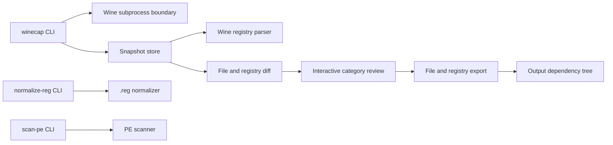
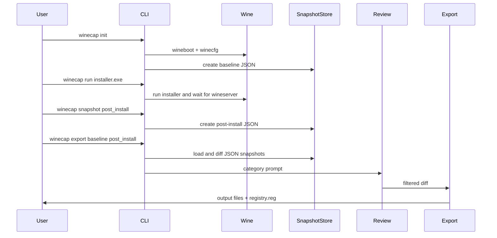

# winecap Architecture

## Purpose

`winecap` is a small preservation and packaging toolchain for Windows installer archaeology under Wine. It answers:

- What files did an installer add or modify?
- What registry keys did it add or modify?
- Which changes look like reusable runtime dependencies, and which look like Wine/session noise?
- How can those changes be exported into a clean dependency bundle?

## System Map

## Component Inventory

| Component | Path | Responsibility |
| --- | --- | --- |
| Main CLI | `src/winecap/cli.py` | Parses `winecap` commands and prints user-facing summaries. |
| Wine boundary | `src/winecap/wine.py` | Owns `wine`, `wineboot`, `winecfg`, and `wineserver` subprocess calls. |
| Snapshots | `src/winecap/snapshots.py` | Hashes prefix files, stores snapshot JSON, and compares file snapshots. |
| Registry | `src/winecap/registry.py` | Parses Wine hives, filters strict runtime noise, diffs keys, and writes `registry.reg`. |
| Review | `src/winecap/review.py` | Groups changes into installer-oriented categories for export review. |
| Export | `src/winecap/export.py` | Copies changed files and delegates registry export. |
| Normalizer | `src/winecap/normalizer.py` | Pure `.reg` analysis, SID cleanup, WOW64 cleanup, splitting, and format conversion. |
| Normalizer CLI | `src/winecap/normalizer_cli.py` | User-facing analysis and write modes for `.reg` files. |
| PE scanner | `src/winecap/pe_scan.py` | Pure-ish PE metadata extraction, with `pefile` imported lazily. |
| PE CLI | `src/winecap/pe_cli.py` | User-facing directory scanner output. |
| Compatibility launchers | `normalize_reg.py`, `scan_pe.py` | Keep the non-conflicting old direct-script entrypoints working from a checkout. |
| Tests | `tests/` | Fast unit coverage for parser, normalizer, diffing, hashing, and PE helpers. |

## Runtime Entrypoints

- `winecap = winecap.cli:main`
- `normalize-reg = winecap.normalizer_cli:main`
- `scan-pe = winecap.pe_cli:main`
- `python -m winecap`
- Legacy direct launchers for `normalize_reg.py` and `scan_pe.py` from the project root.

## Data Flow

## Ownership Boundaries

- CLI modules own terminal UX, argument parsing, and print formatting.
- Domain modules return data or write narrowly scoped artifacts.
- `wine.py` is the only module that should invoke Wine subprocesses.
- `pe_scan.py` is the only module that should know about `pefile`.
- Compatibility launchers should stay tiny and should not regain business logic. The historical `winecap.py` launcher was removed because its filename shadowed the `winecap` package; use the installed `winecap` command or `python -m winecap` instead.

## Known Constraints

- Wine registry files are not standard Windows `.reg` exports. The parser handles key headers, simple values, default values, and continued value lines, but it is intentionally conservative.
- Exported registry deletions are tracked in diffs but not currently written to `registry.reg`.
- Interactive review is category-level, not per-file or per-key.
- `winecap init --force` removes an existing prefix only after dangerous-path checks and positive Wine-prefix identification.
