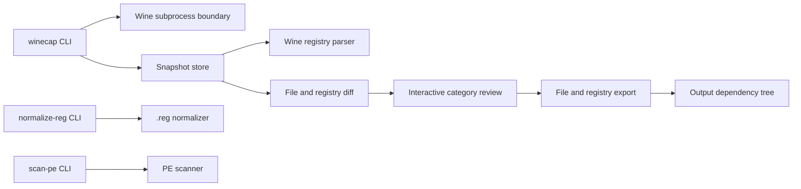
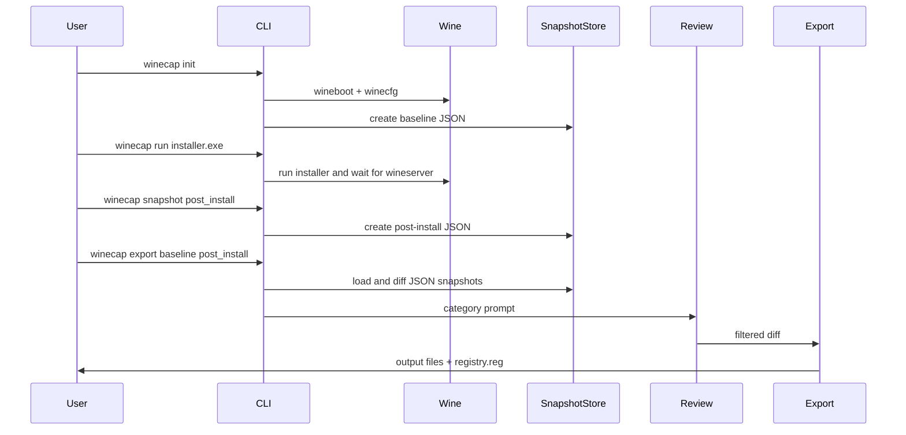

# winecap Architecture

## Purpose

`winecap` is a small preservation and packaging toolchain for Windows installer archaeology under Wine. It answers:

- What files did an installer add or modify?
- What registry keys did it add or modify?
- Which changes look like reusable runtime dependencies, and which look like Wine/session noise?
- How can those changes be exported into a clean dependency bundle?

Confidence: high. This is directly reflected in the command names, README workflow, and module responsibilities.

## System Map

## Component Inventory

| Component | Path | Responsibility |
| --- | --- | --- |
| Main CLI | `src/winecap/cli.py` | Parses `winecap` commands and prints user-facing summaries. |
| Wine boundary | `src/winecap/wine.py` | Owns `wine`, `wineboot`, `winecfg`, and `wineserver` subprocess calls. |
| Snapshots | `src/winecap/snapshots.py` | Hashes prefix files, stores snapshot JSON, and compares file snapshots. |
| Registry | `src/winecap/registry.py` | Parses Wine hives, filters strict runtime noise, diffs keys, and writes `registry.reg`. |
| Review | `src/winecap/review.py` | Groups changes into installer-oriented categories for export review. |
| Export | `src/winecap/export.py` | Copies changed files and delegates registry export. |
| Normalizer | `src/winecap/normalizer.py` | Pure `.reg` analysis, SID cleanup, WOW64 cleanup, splitting, and format conversion. |
| Normalizer CLI | `src/winecap/normalizer_cli.py` | User-facing analysis and write modes for `.reg` files. |
| PE scanner | `src/winecap/pe_scan.py` | Pure-ish PE metadata extraction, with `pefile` imported lazily. |
| PE CLI | `src/winecap/pe_cli.py` | User-facing directory scanner output. |
| Compatibility launchers | `winecap.py`, `normalize_reg.py`, `scan_pe.py` | Keep old direct-script entrypoints working from a checkout. |
| Tests | `tests/` | Fast unit coverage for parser, normalizer, diffing, hashing, and PE helpers. |

## Runtime Entrypoints

- `winecap = winecap.cli:main`
- `normalize-reg = winecap.normalizer_cli:main`
- `scan-pe = winecap.pe_cli:main`
- `python -m winecap`
- Legacy direct launchers from the project root.

## Data Flow

## Ownership Boundaries

- CLI modules own terminal UX, argument parsing, and print formatting.
- Domain modules return data or write narrowly scoped artifacts.
- `wine.py` is the only module that should invoke Wine subprocesses.
- `pe_scan.py` is the only module that should know about `pefile`.
- Compatibility launchers should stay tiny and should not regain business logic.

## Known Constraints

- Wine registry files are not standard Windows `.reg` exports. The parser handles key headers, simple values, default values, and continued value lines, but it is intentionally conservative.
- Exported registry deletions are tracked in diffs but not currently written to `registry.reg`.
- Interactive review is category-level, not per-file or per-key.
- `winecap init --force` removes an existing prefix. That remains a deliberate CLI-level destructive option.

## Confusion Register

| Question | Confidence | Current answer |
| --- | --- | --- |
| Should removed files or registry keys be exported as removal scripts? | Requires author confirmation | The historical tool counted removals but did not export them. |
| Should category review eventually support per-item selection? | Medium | Category-level review matches the historical script and keeps exports fast. |
| Are Wine hive formats stable enough for this parser? | Medium | Current parser covers observed simple Wine hive syntax; broader fixture coverage would improve confidence. |
| Should PE scan output become JSON/CSV? | Low | The existing behavior is human-readable terminal output only. |

## Comprehensibility Scorecard

| Area | Score | Notes |
| --- | ---: | --- |
| Onboarding clarity | 8/10 | README has install, workflows, commands, and development checks. |
| Execution discoverability | 9/10 | All runtime entrypoints are listed in `pyproject.toml` and documented here. |
| Architecture coherence | 8/10 | Script-era logic is split around subprocess, snapshot, registry, review, export, normalizer, and PE responsibilities. |
| Data-flow clarity | 8/10 | Snapshot and export flow is documented with a sequence diagram. |
| Decision documentation | 7/10 | Initial ADR exists; more ADRs would help if export semantics change. |
| Test trust | 6/10 | Pure logic has fast tests. Wine integration still needs manual or containerized validation. |
| Change safety | 7/10 | Tests cover refactored behavior, but real Wine fixture snapshots would raise confidence. |

## Next Refactor Backlog

1. Add fixture-based tests from real `system.reg`, `user.reg`, and `userdef.reg` files.
2. Add optional machine-readable output for `scan-pe`.
3. Add per-item export review or a saved review manifest if category-level filtering proves too coarse.
4. Decide whether removed registry keys should generate deletion entries in exported `.reg` files.
5. Add an integration smoke script for a tiny throwaway Wine prefix on a Linux host with Wine installed.
